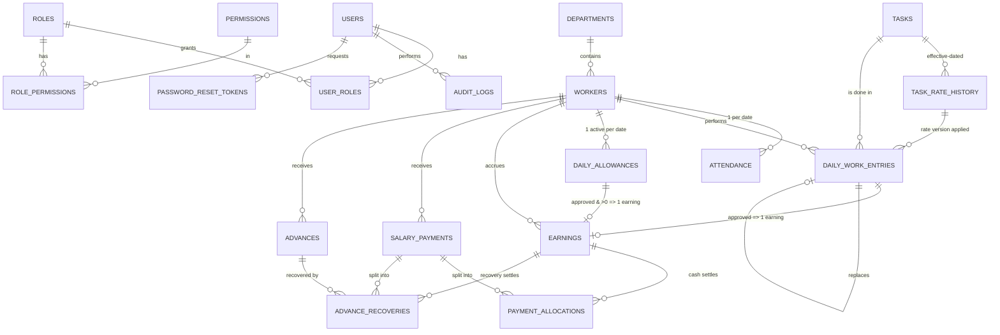

# FBM Labor & Task-Based Salary System: Phase 1 Architecture

Status: **approved; Phase 2 implemented** (see `README.md`).
Companion file: `prisma/schema.prisma`.

---

## 0. Decisions I need from you before Phase 4 (financial modules)

Phases 2 and 3 can proceed without these. Phase 4 cannot. Each question has my proposed default, so a reply of "defaults are fine" is enough.

| # | Question | Why it matters | Proposed default |
|---|---|---|---|
| Q1 | **Who approves draft work entries and allowances?** | Decides when money becomes payable. | **RESOLVED:** The Manager runs the whole system (enters, approves, settles). No separate operator workflow. Default action is **Save & Approve**; **Save as draft** and bulk **Approve day** remain available. |
| Q2 | **What if an approved entry must be corrected after part of it was already paid?** E.g. 20 units corrected to 15 after Rs. 800 of that day was paid. | A reduced earning can fall below what was already settled, creating a negative balance. | **Block** the correction until the settlement that touched that earning is reversed (authorized, with reason), then void and replace the entry. No negative balances and no hidden "worker owes us" amounts. |
| Q3 | **Reversing a payment:** whole payment only, or individual allocations? | Controls the complexity of audit history. | Whole payment only. To fix a payment, reverse it entirely and post a new one. |
| Q4 | **Advance recovery mechanics.** A settlement = cash + recovery. How is the recovery applied to dates? | Per-date paid/partial status. | Both amounts form one pool, applied oldest-first within the selected period (recovery portion first, then cash, within each date). Recovery is drawn from the worker's oldest advance first. Recovery can never exceed the advance balance or the period's outstanding wages. |
| Q5 | **Overpayment.** Paying more than the period's outstanding is blocked (per your spec). If the manager wants to hand over extra, it must be an Advance. Confirm. | Prevents silent over-settlement. | Confirmed as blocked; extra money must be recorded as an advance. |
| Q6 | **Does a worker need to be present (attendance) to have work entries?** | Data-entry validation. | No dependency. Attendance and production are fully independent (your rule 6). A UI hint may show "no attendance marked" but never blocks. |
| Q7 | **Same task twice for one worker on one date.** | Uniqueness. | One active line per (worker, date, task). To change quantity, edit while DRAFT or void-and-replace once APPROVED. Quantity is the multiplier, so there is no need for two lines. |

**Decisions confirmed so far:** Q1 resolved as above. Q2 to Q7 accepted at the proposed defaults. The Manager may reverse payments (with a reason; audited).

**Assumptions I'm making (tell me if any are wrong):**

- Currency is PKR with 2 decimals (paisa) stored as `Decimal(14,2)`. Task amounts round half-up to 2 dp.
- `PER_UNIT` and `FIXED_PER_TASK` use the same math (`quantity × appliedRate`). The distinction is stored and shown (labels, reports), but no formula differs. A pricing method cannot be changed once a task has entries.
- Quantities may be fractional (`Decimal(12,3)`) for PER_UNIT; FIXED_PER_TASK quantities must be whole numbers.
- A rate applies from its `effectiveFrom` date. Entering work for a past date uses the rate that was in effect **on that work date**, then snapshots it into the entry.
- A zero-amount allowance or zero-amount entry creates **no** earning row.
- "Week/month" boundaries and "today" use the `Asia/Karachi` timezone.
- One company, one currency, one factory. No multi-tenancy.
- Attendance corrections are allowed to Manager/Admin; every change is audited.

---

## 1. Architecture proposal

**One Next.js 15 (App Router) application + one PostgreSQL database.** No microservices, queues, or separate API.

```
src/
  app/
    (auth)/login, change-password, reset-password
    (app)/                      # authenticated shell: sidebar / mobile drawer
      dashboard/
      workers/ [id]/
      tasks/
      attendance/
      work-entry/
      allowances/
      salary/ (preview, settle, history, [paymentId])
      advances/
      reports/ (monthly, statement, attendance, production, outstanding, advances)
      users/
      settings/
    api/auth/[...nextauth]/route.ts
    api/reports/[type]/export/route.ts     # xlsx / pdf streaming
  server/
    auth/        config.ts, password.ts (argon2id), session.ts, rate-limit.ts
    authz/       permissions.ts, require.ts (requirePermission), roles-seed.ts
    db/          prisma.ts, tx.ts (transaction + raw-lock helpers)
    money/       decimal.ts (Decimal helpers, rounding, PKR format)
    services/
      rates.service.ts          rate resolution by work date
      work-entry.service.ts     create/approve/void/replace
      allowance.service.ts
      earnings.service.ts       ledger writes (only caller of Earning create/reverse)
      allocation.engine.ts      PURE function: oldest-first allocation
      settlement.service.ts     preview / post / reverse
      advance.service.ts
      balance.service.ts        read-side balance + per-date status queries
      report.service.ts
      audit.service.ts
    actions/     thin Server Actions: parse (Zod) -> authorize -> call service
    validators/  zod schemas (shared with forms)
  components/    ui/ (shadcn), data-table/, forms/, layout/
  lib/           utils, constants
prisma/          schema.prisma, migrations/, seed.ts
tests/           unit (engine, money), integration (settlement, concurrency), e2e (smoke)
```

**Layering rule (enforced by code review and lint):**

1. UI components never touch Prisma.
2. Server Actions / Route Handlers do only: Zod parse → `requirePermission()` → call a service → revalidate.
3. **Services are the only place business logic and Prisma writes live.** Financial tables (`Earning`, `SalaryPayment`, `PaymentAllocation`, `Advance`, `AdvanceRecovery`) are written only by `earnings.service`, `settlement.service`, `advance.service`.
4. Balances shown in the UI always come from `balance.service` (server). The client may *preview* totals for UX, but the server recomputes and validates on submit.

**Key libraries:** Next.js, React, TypeScript (strict), Tailwind, shadcn/ui, Prisma, Zod, React Hook Form + `@hookform/resolvers`, TanStack Table, Recharts (via shadcn charts), lucide-react, Auth.js v5 (Credentials), `@node-rs/argon2`, `decimal.js` (Prisma.Decimal), `exceljs` (xlsx), `@react-pdf/renderer` or server-side print-CSS PDF, Vitest + Testcontainers/real Postgres for integration tests, Playwright for smoke e2e.

**Hosting assumption (Phase 7):** a single VPS or container host (Docker Compose: app + Postgres + reverse proxy with TLS), nightly `pg_dump` with off-site copy and a tested restore.

---

## 2. ER diagram



**How to read the money flow:**

```
Approved entry / allowance ──► EARNING (amount, settledAmount)
                                   ▲            ▲
        SALARY_PAYMENT ──► PAYMENT_ALLOCATION   │ (cash)
        SALARY_PAYMENT ──► ADVANCE_RECOVERY ────┘ (advance → earning)

outstanding(earning) = amount − settledAmount
settledAmount        = Σ allocations + Σ recoveries   (POSTED payments only)
```

Advance cash handed out is **never** an earning. It is an `Advance` row, and only becomes "recovered" when an `AdvanceRecovery` links it to a real earning.

---

## 3. Salary calculation logic

### 3.1 Daily amounts
```
taskAmount  = round_half_up(quantity × appliedRate, 2)
dayEarning  = Σ approved task earnings on that date + approved allowance on that date
```
Allowance and task earnings are **separate ledger rows** (`sourceType` differs), so reports can split them.

### 3.2 Per-date payment status (derived, never stored)
For worker W and date D, over ACTIVE earnings:
```
earned  = Σ amount          settled = Σ settledAmount
Paid           : earned > 0 and settled = earned
Partially Paid : 0 < settled < earned
Unpaid         : settled = 0
```

### 3.3 Oldest-first allocation (pure function, heavily unit-tested)

```ts
// allocation.engine.ts: no DB access, no side effects
type EarningRow = { id: string; workDate: string; createdAt: string; outstanding: Decimal };

function allocateOldestFirst(
  earnings: EarningRow[],     // already filtered to worker + period + outstanding > 0
  cash: Decimal,
  recovery: Decimal
): { earningId: string; cash: Decimal; recovery: Decimal }[] {
  // 1. sort by workDate ASC, createdAt ASC, id ASC   (deterministic)
  // 2. walk the list; for each earning:
  //      take = min(outstanding, remainingRecovery + remainingCash)
  //      recoveryPart = min(take, remainingRecovery)
  //      cashPart     = take − recoveryPart
  //      emit row if take > 0; decrement the remaining pools
  // 3. invariant: Σ cash == cash AND Σ recovery == recovery, else throw
}
```

Worked example from your spec: outstanding 1000 / 800 / 1200, pay 1500, giving allocations 1000 / 500 / 0 and remaining 0 / 300 / 1200.

### 3.4 Balance formulas
```
Worker outstanding wages  = Σ (amount − settledAmount) over ACTIVE earnings
Worker unrecovered advance = Σ (amount − recoveredAmount) over ACTIVE advances
Monthly wages earned      = Σ earnings.amount WHERE workDate in month AND status ACTIVE
Monthly cash paid         = Σ salary_payments.cashAmount WHERE paymentDate in month AND status POSTED
Outstanding as of date X  = Σ earnings(workDate ≤ X).amount − Σ allocations/recoveries
                            from payments with paymentDate ≤ X (POSTED)
```
Outstanding "as of a past date" is computed from allocation/payment dates, not from the current `settledAmount`, so historical reports stay correct.

---

## 4. Financial service breakdown

### 4.1 `rates.service`
- `resolveRate(taskId, workDate)` returns `{ rateHistoryId, rate }` using the greatest `effectiveFrom ≤ workDate`. Throws if none.
- `changeRate(taskId, newRate, effectiveFrom, reason)`: inserts a history row only (append-only). Never touches existing entries. Audited as `rate.change`.

### 4.2 `work-entry.service`
- `create` (DRAFT): resolves rate, snapshots `pricingMethod`, `appliedRate`, `amount`.
- `update` (DRAFT only).
- `saveAndApprove` (tx, the default UI action): create + approve + `earnings.service.createForEntry()` in one transaction.
- `approve` (tx): for previously saved DRAFTs; status to APPROVED, then `earnings.service.createForEntry()`. `approveDay(date)` approves all drafts of a date atomically.
- `void(reason)` (tx): if the earning has `settledAmount > 0`, throw `SETTLED_EARNING` (see Q2). Otherwise, mark the earning REVERSED and the entry VOIDED.
- `replace(oldId, newData)` (tx): void old + create new DRAFT with `replacesEntryId`.

### 4.3 `allowance.service`
Same lifecycle as work entries. Amount ≥ 0. Zero creates no earning.

### 4.4 `earnings.service` (sole writer of the ledger)
- `createForEntry / createForAllowance`: inserts `Earning` when amount > 0. The `@unique` on `workEntryId` / `allowanceId` makes duplicates impossible even under races.
- `reverse(earningId, reason)`: allowed only if `settledAmount = 0`; sets REVERSED.

### 4.5 `settlement.service`

**`preview(workerId, periodStart, periodEnd)`**: read-only. Returns per-date rows (earned / settled / outstanding / status), period totals, and the worker's advance balance.

**`post(input, actor)`**, one DB transaction:

```
1. Zod-validate; requirePermission('settlement:create');
   if recovery > 0 → also 'advance:recover'.
   cash >= 0, recovery >= 0, cash + recovery > 0; periodStart <= periodEnd.
2. BEGIN
3. Idempotency: if payment with this idempotencyKey exists → return it (no double post).
4. Serialize per worker:   SELECT id FROM workers WHERE id = $1 FOR UPDATE;
5. Lock earnings:
     SELECT … FROM earnings
     WHERE "workerId"=$1 AND status='ACTIVE'
       AND "workDate" BETWEEN $start AND $end
       AND amount > "settledAmount"
     ORDER BY "workDate", "createdAt", id
     FOR UPDATE;
6. outstanding = Σ(amount − settledAmount) (fresh, under lock).
   if cash + recovery > outstanding → throw EXCEEDS_OUTSTANDING.
7. if recovery > 0:
     lock advances (ACTIVE, oldest first) FOR UPDATE;
     if recovery > Σ(advance outstanding) → throw EXCEEDS_ADVANCE_BALANCE.
8. plan = allocateOldestFirst(earnings, cash, recovery)
9. INSERT salary_payments (receiptNo, totals, period, actor)
10. INSERT payment_allocations (cash parts)
11. For recovery parts: pair (advance oldest-first) × (earning oldest-first) with a two-pointer
    walk → INSERT advance_recoveries (advanceId, earningId, paymentId, amount);
    UPDATE advances SET recoveredAmount += …
12. UPDATE earnings SET settledAmount += (cash part + recovery part)
13. INSERT audit_logs (settlement.post, after = full plan)
14. COMMIT
```
The DB CHECKs (section 5) are the safety net: even a buggy service cannot over-settle an earning or over-recover an advance.

**`reverse(paymentId, reason, actor)`** (permission `settlement:reverse`), one transaction:
```
lock worker row + the payment's earnings + advances FOR UPDATE
if payment.status = REVERSED → throw
UPDATE earnings SET settledAmount −= (allocation + recovery) for each affected earning
UPDATE advances SET recoveredAmount −= recovery
UPDATE salary_payments SET status=REVERSED, reversedBy, reversedAt, reversalReason
(allocation and recovery rows are kept, never deleted)
audit_logs (payment.reverse, before/after)
```
Corrected payments are posted as new settlements. Reversed payments stay visible in statements, flagged as reversed.

### 4.6 `advance.service`
- `issue(worker, date, amount, notes)`: creates `Advance`. No ledger impact.
- `void(advanceId, reason)`: only if `recoveredAmount = 0`.
- Recovery happens **only** inside `settlement.post` (explicit manager choice, never automatic).

### 4.7 `balance.service` (read side)
`workerBalance`, `perDateStatus`, `outstandingAsOf(date)`, `dashboardTotals(month)`, and `reconcile()`, a job/CLI that recomputes `settledAmount` and `recoveredAmount` from allocation/recovery rows and reports any drift (should always be zero).

### 4.8 `audit.service`
`log({ action, entity, before, after, meta })`, called **inside** the same transaction as the change it records, so an action and its audit row succeed or fail together.

---

## 5. Database-level integrity (raw SQL migration)

Prisma can't express these, so they live in `prisma/sql/financial_constraints.sql`, which `npm run db:init` appends to the generated init migration (single migration, applied once). The file is the authoritative version; the excerpt below is abbreviated:

```sql
-- Earnings
ALTER TABLE earnings ADD CONSTRAINT earnings_amount_positive CHECK (amount > 0);
ALTER TABLE earnings ADD CONSTRAINT earnings_settled_bounds
  CHECK ("settledAmount" >= 0 AND "settledAmount" <= amount);
ALTER TABLE earnings ADD CONSTRAINT earnings_single_source
  CHECK ((("workEntryId" IS NOT NULL)::int + ("allowanceId" IS NOT NULL)::int) = 1);

-- Advances
ALTER TABLE advances ADD CONSTRAINT advances_amount_positive CHECK (amount > 0);
ALTER TABLE advances ADD CONSTRAINT advances_recovered_bounds
  CHECK ("recoveredAmount" >= 0 AND "recoveredAmount" <= amount);

-- Payments / allocations
ALTER TABLE salary_payments ADD CONSTRAINT payments_amounts
  CHECK ("cashAmount" >= 0 AND "advanceRecoveryAmount" >= 0
         AND "totalSettled" = "cashAmount" + "advanceRecoveryAmount"
         AND "totalSettled" > 0);
ALTER TABLE salary_payments ADD CONSTRAINT payments_period CHECK ("periodStart" <= "periodEnd");
ALTER TABLE payment_allocations ADD CONSTRAINT alloc_positive CHECK (amount > 0);
ALTER TABLE advance_recoveries  ADD CONSTRAINT recov_positive CHECK (amount > 0);

-- Work / allowance
ALTER TABLE daily_work_entries ADD CONSTRAINT entry_qty_positive CHECK (quantity > 0);
ALTER TABLE daily_work_entries ADD CONSTRAINT entry_rate_nonneg CHECK ("appliedRate" >= 0);
ALTER TABLE daily_allowances   ADD CONSTRAINT allowance_nonneg CHECK (amount >= 0);
ALTER TABLE task_rate_history  ADD CONSTRAINT rate_nonneg CHECK (rate >= 0);

-- One ACTIVE line per key (voided rows excluded so void-and-replace works)
CREATE UNIQUE INDEX uq_work_entry_active
  ON daily_work_entries ("workerId", "workDate", "taskId") WHERE status <> 'VOIDED';
CREATE UNIQUE INDEX uq_allowance_active
  ON daily_allowances ("workerId", "workDate") WHERE status <> 'VOIDED';

-- Audit log is append-only
CREATE FUNCTION audit_logs_immutable() RETURNS trigger AS $$
BEGIN RAISE EXCEPTION 'audit_logs is append-only'; END; $$ LANGUAGE plpgsql;
CREATE TRIGGER audit_logs_no_update BEFORE UPDATE OR DELETE ON audit_logs
  FOR EACH ROW EXECUTE FUNCTION audit_logs_immutable();
```

Additional guard (also in the migration): triggers that reject UPDATE of `earnings.amount`, `workerId`, and `workDate`, and of `salary_payments` money fields. Amounts are immutable; corrections are reversals.

**Concurrency summary:** per-worker `FOR UPDATE` lock serializes settlements for the same worker; earning/advance row locks guard the exact rows; CHECK constraints are the last line of defense; `idempotencyKey` stops double-clicks and retries.

---

## 6. Authentication and permissions

### 6.1 Authentication
- **Auth.js v5 Credentials provider**, username or email + password.
- Passwords hashed with **argon2id** (`@node-rs/argon2`). Minimum length 10, checked against a small common-password list.
- **JWT session cookie** (httpOnly, Secure, SameSite=Lax), which Auth.js requires for Credentials. The JWT carries `userId` and `sessionVersion`; **every protected server call re-checks `isActive` and `sessionVersion` against the DB**, so deactivating a user or changing a password kills existing sessions immediately.
- Session lifetime: 8 hours absolute, 30 minutes sliding refresh for activity (configurable). Mobile managers re-login daily.
- **Brute-force protection:** `failedLoginCount` + `lockedUntil` (5 failures → 15-minute lock, escalating), plus an IP-based limiter on the login route. Generic error messages (no user enumeration). All attempts audited.
- **Password change** (requires current password) and **admin-initiated reset** (one-time token stored hashed, short expiry, forces `mustChangePassword`). No email dependency in v1: Admin issues a temporary password.
- Account deactivation: `isActive=false` + bump `sessionVersion`.
- Security headers via `next.config` (CSP, HSTS, X-Frame-Options, Referrer-Policy). Server Actions' built-in Origin check supplies CSRF protection.

### 6.2 Authorization
- Permissions are string codes: `worker:read`, `worker:write`, `task:write`, `rate:change`, `attendance:write`, `attendance:correct`, `work:enter`, `work:approve`, `work:void`, `allowance:write`, `allowance:approve`, `settlement:read`, `settlement:create`, `settlement:reverse`, `advance:read`, `advance:issue`, `advance:recover`, `advance:void`, `report:read`, `report:export`, `user:manage`, `settings:manage`, `audit:read`.
- `requirePermission(code)` (implemented in `src/server/authz/require.ts`) runs **inside every Server Action, Route Handler, and data-fetching function**. Middleware only does a cheap "is there a session?" redirect and is **not** treated as authorization.
- UI hides actions the user can't perform (convenience only).

| Permission area | Admin | Manager | Viewer |
|---|:-:|:-:|:-:|
| Workers: read / write | ✔ / ✔ | ✔ / ✔ | read |
| Tasks & rate changes | ✔ | ✔ | read |
| Attendance: enter / correct | ✔ | ✔ | – |
| Work entry & allowances: enter, approve, void | ✔ | ✔ | – |
| Settlement: preview / post / reverse | ✔ | ✔ | read |
| Advances: issue / recover / void | ✔ | ✔ | read |
| Reports: view / export | ✔ | ✔ | ✔ |
| Audit log: read | ✔ | ✔ | – |
| Users, roles, settings | ✔ | – | – |

**Roles seeded in v1: ADMIN, MANAGER, VIEWER.** The Manager is the working role for all daily operations. Admin is a superset of Manager that additionally manages users and settings (one person may hold both roles). The `OPERATOR` role from the original spec is not seeded; because roles and permissions are data (not code), it can be added later without code changes.

*Payment reversals by the Manager require a written reason and are fully audited. If you want reversals and rate changes restricted to Admin, it is a one-line change in the permission map.*

Roles and permissions are seeded as system data; the `roles` / `permissions` tables allow later customization without code changes.

### 6.3 Audit coverage
Login success/failure/lockout, password changes, user/role changes, worker create/edit/status, task create/edit and every rate change, attendance corrections, entry create/approve/void/replace, allowance changes, settlement post/reverse, advance issue/void/recovery, report exports. Each row stores actor, action, entity, before/after JSON, IP, and user-agent.

---

## 7. Reporting notes
- **Earned** is bucketed by `workDate`; **cash paid** is bucketed by `paymentDate`. A November payment for October wages appears in November's cash report and October's earnings. The two figures are never merged.
- Dashboard shows four separate cards: *Wages earned (this month)*, *Cash paid (this month)*, *Outstanding wages (as of date)*, *Unrecovered advances*.
- Excel export via `exceljs`; PDF/print via print-optimized report pages. Exports run server-side with the same permission checks.

## 8. Responsive / PWA notes
- shadcn `Sheet` as the mobile drawer; sidebar on `lg+`.
- TanStack Table on desktop; on `< md`, rows render as stacked cards (shared column definitions drive both).
- Inputs ≥ 44px tall, `inputMode="decimal"` for money/quantity, native `<input type="date">` on mobile.
- PWA: manifest + icons + service worker caching **static assets only**. API/Server Action calls are never cached or queued; settlements require a live connection.

---

## 9. Development roadmap

| Phase | Scope | Exit criteria |
|---|---|---|
| **1. Architecture** (this doc) | Schema, services, auth design | You approve; Q1–Q7 answered |
| **2. Setup** (in progress) | Next.js + TS + Tailwind + shadcn-style UI, Prisma + Postgres (Docker Compose), migrations incl. raw constraints, Auth.js login/logout/change-password, seed roles + users, responsive app shell (sidebar/drawer), audit service, money helpers, unit tests | Log in, role-gated shell, migrations apply on a clean DB |
| **3. Core modules** | Workers, Tasks & rate history, Attendance (single + bulk), Work entry (bulk grid, draft/approve/void), Allowances | Per-day totals correct; rate change doesn't alter old entries (test) |
| **4. Financial** | Earnings ledger, settlement preview/post/reverse, allocation engine, partial payments, advances, recovery | Spec example passes; concurrency test: two simultaneous settlements never over-settle; `reconcile()` shows zero drift |
| **5. Reports** | Dashboard, 6 reports, filters, print, Excel/PDF | Earned vs cash separation verified with an Oct-earned/Nov-paid fixture |
| **6. Security & testing** | Permission matrix tests, audit review, rate limiting, error boundaries, backup/restore drill | Every server action has an authz test; restore verified |
| **7. Deployment** | Docker image, env/secrets, TLS reverse proxy, scheduled backups, PWA manifest, runbook | Production deploy checklist signed off |

**Test strategy highlights:** unit tests on `allocateOldestFirst` and money rounding (property-based: Σ allocations = pool, never exceed outstanding); integration tests against real Postgres for settlement, reversal, advance recovery, and a parallel-settlement race; permission tests per role; one Playwright smoke path (login → entry → approve → settle → statement).

---

## 10. Next step
Phase 3 (Core modules: workers, tasks and rates, attendance, work entry, allowances). See `README.md` for Phase 2 run and test instructions.
